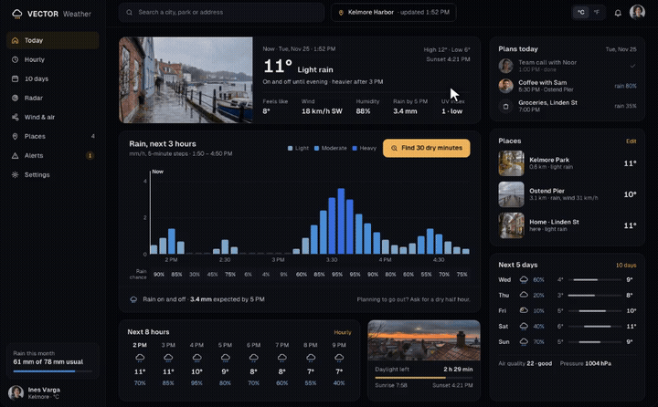

# Walk Window

**Rain all afternoon, and I still wanted a walk. The app found me 30 dry minutes.**



**Live demo:** [veraetogrex-portfolio.github.io/walk-window](https://veraetogrex-portfolio.github.io/walk-window/) · **Mockup:** [full-screen version](https://veraetogrex-portfolio.github.io/walk-window/mockup/walk-window.html)

A weather screen that walks a 3-hour rain forecast in 5-minute steps, skips a break that is too short, lights up the first 30 dry minutes and puts the walk into today's plans with a reminder. Vanilla HTML/CSS/JS, zero dependencies.

## Try it

- Press Find 30 dry minutes. The app walks the "Rain, next 3 hours" scale left to right, one 5-minute step every 0.1 s: rainy steps dim, the 15-minute break at 2:10 PM is marked "15 min · too short", dry steps from 2:40 light up amber one by one.
- When six dry steps line up, 2:40–3:10 PM is highlighted with "2:40 – 3:10 PM · dry 30 min", the rain chances 6 %, 4 %, 9 % are marked and the footer reads "Go at 2:40 PM — dry for 30 minutes". Extra presses during the search change nothing.
- Press Remind me at 2:30 PM. The button turns into "Reminder set · 2:30 PM", the bell shows 1 and "Walk · Kelmore Park, 2:40 – 3:10 PM · dry" slides into Plans today, pushing the cards below down.
- Switch °C / °F in the top bar: every temperature on the screen converts.
- A forecast with no dry half hour: run `document.querySelector('.vw').weatherApp.reset('steady')` and press Find — the app answers "No dry 30 minutes before 4:50 PM" and marks the longest break.
- Keyboard: Tab to Find 30 dry minutes and press Enter, then Tab to Remind me and press Enter or Space.
- With reduced motion on, the walk lands in the plans at once and the highlights switch without fading; the step-by-step check still runs.

## Use it

Three files and the photos, no build step, no dependencies:

```
index.html   markup
style.css    styles
script.js    logic
assets/      the photos and portraits (generated, free to reuse with the code)
```

Download the repo and open `index.html`, or copy the files into your project. Set `data-assets` on `<section class="vw">` to the folder with your photos. The section gets `weatherApp` with `reset()`, `find()`, `remind()` and `units('c' | 'f')`.

## License

MIT
